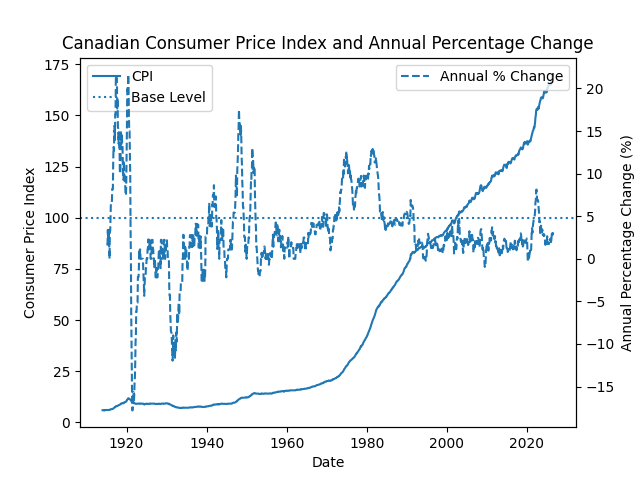

# FINE3300-2026-A2 - Consumer Price Index Inflation Calculator

## Project Overview

This project was created for FINE 3300 – Python for Finance Professionals. Assignment 2 requires the use of data files, Pandas, NumPy, and Matplotlib to read data, extract information, perform calculations, and create a visualization. [1]

The project focuses on the Canadian Consumer Price Index (CPI). CPI represents the price level of a basket of goods and services experienced by households. In Canada, CPI is measured monthly and changes in CPI can be used to examine changes in the cost of consumer goods and services over time. [1][5][6]

The main goal of this project is to replicate and enhance the Bank of Canada Inflation Calculator. The Bank of Canada calculator compares the cost of goods and services between two periods using CPI data and reports the percentage change, number of years, average annual rate of inflation, and CPI values for the selected periods. [1][5]

The Bank of Canada calculates the equivalent cost using the relationship:

`Cost 2 = Cost 1 × (CPI 2 / CPI 1)` [5]

Assignment 2 extends the original calculator because the CPI data is available monthly while the Bank of Canada calculator asks the user to enter years. For this project, the user enters a price, a first date, and a second date using the `YYYY-MM` format. The program validates the inputs, locates the corresponding monthly CPI values, and calculates the inflation results. [1]

The CPI data is read into a Pandas DataFrame. FINE 3300 Lecture 6 introduces Pandas for working with tabular data and demonstrates reading CSV files, accessing rows and columns, and filtering observations using conditions. [2]

Matplotlib is used to create a graph containing both the CPI time series and the annual percentage change. Assignment 2 requires the percentage change to be displayed using the right-hand axis and also requires a dotted line through the CPI base level, appropriate axis labels, a title, a legend, and a saved PNG image. [1][3]

NumPy is also used as part of the numerical calculation in the program. FINE 3300 Lecture 8 introduces NumPy as a numerical computing package and covers numerical arrays, matrix operations, statistics, and its use with Matplotlib. [4]


## Project Files

### `Inflation Calculator.py`

This is the main Python file for the project. It reads and prepares the CPI data, creates the CPI visualization, collects and validates user inputs, retrieves the required CPI observations, and performs the inflation calculations. [1][2][3][4]

### `STATIC_INFLATIONCALC.csv`

This file contains the monthly CPI data used by the calculator. The Bank of Canada Inflation Calculator uses monthly CPI data and identifies Statistics Canada Consumer Price Index data as its data source. [5][6]

### `CPI_Graph.png`

This image is created by the Python program using Matplotlib. It contains the CPI time series, annual percentage change, and CPI base level. Assignment 2 specifically requires the CPI graph to be included in the README along with a short commentary. [1][3]

### `README.md`

This file serves as the project write-up. Assignment 2 requires the README to provide an introduction, descriptions of the project files, enough information for a user to replicate and interact with the project, the CPI graph with commentary, and a sample of the calculator output. [1]


## Libraries Used

The project uses Pandas, NumPy, and Matplotlib, which are the main libraries identified in Assignment 2. [1]

### Pandas

Pandas is used to read the CPI CSV file into a DataFrame and work with the CPI observations. Lecture 6 demonstrates `pd.read_csv()`, DataFrames, column access, `.iloc[]`, and conditional filtering of DataFrame observations. [2]

The annual percentage change is calculated with the Pandas `pct_change()` method. Pandas documentation explains that `pct_change()` calculates the fractional change between the current value and a prior value. The `periods` argument determines how many observations back are used in the comparison. Because the CPI dataset is monthly, `periods=12` compares each observation with the same month one year earlier. The result is multiplied by 100 to express the change as a percentage. [7]

### NumPy

NumPy is introduced in Lecture 8 as a package for numerical computing. The lecture covers importing NumPy using `import numpy as np`, numerical arrays, matrix operations, statistics, and plotting NumPy data with Matplotlib. [4]

The program uses `np.power()` when calculating the annualized rate of change. NumPy documents `power()` as raising values to a specified exponent. [10]

### Matplotlib

Matplotlib is used to create and save the CPI graph. Lecture 7 covers line graphs, figures and axes, graph titles, axis labels, legends, line styles, and saving figures as images. [3]

The graph uses `twinx()` to create a second y-axis for the annual percentage change. Matplotlib documents `twinx()` as creating a new Axes that shares the original x-axis while using an independent y-axis on the right side. This allows the CPI level and percentage change to be displayed together using different scales. [8]

The graph also uses `axhline()` to draw the horizontal CPI base-level line. Matplotlib documents `axhline()` as a method for adding a horizontal line across an Axes. [9]


## How to Run the Program

All project files should be kept in the same project folder so that the Python program can read `STATIC_INFLATIONCALC.csv` and save the generated graph in the project directory. The CPI file is read into Pandas using `pd.read_csv()`, which is demonstrated in FINE 3300 Lecture 6. [2]

Before running the program, Pandas, NumPy, and Matplotlib must be available in the Python environment. The FINE 3300 lectures provide installation and import instructions for these libraries. [2][3][4]

The libraries can be installed from the terminal using:

```bash
python3 -m pip install pandas
python3 -m pip install numpy
python3 -m pip install matplotlib
```

The program can then be run from the project folder using:

```bash
python3 "Inflation Calculator.py"
```

The program asks the user for three inputs: the price of the goods or services, the first date, and the second date. Assignment 2 specifically requires these inputs and requires validation to ensure that the selected dates are contained within the CPI dataset. [1]

The dates are entered using the `YYYY-MM` format.

Example:

```text
Enter the price of goods or services: $100
Enter the first date (YYYY-MM): 2020-01
Enter the second date (YYYY-MM): 2026-09
```

The program checks the price and dates before performing the calculations. Once valid dates are provided, Pandas filtering is used to locate the CPI observations corresponding to the two selected months. Conditional filtering and accessing individual observations with `.iloc[]` are techniques covered in Lecture 6. [2]

The calculator then reports the equivalent price, percentage change, number of years, annual rate of change, and CPI values for the two selected periods. These are the results identified in Assignment 2 and by the Bank of Canada Inflation Calculator. [1][5]

The program also creates and saves the CPI graph as:

`CPI_Graph.png`

Assignment 2 requires the graph to contain the CPI time series and annual percentage change, with percentage change displayed on the right-hand axis. It also requires a dotted line through the CPI base level, appropriate labels, a title, a legend, and a saved PNG image. [1]


## CPI Visualization

The graph generated by the program is shown below.



The solid line displays the level of the Canadian CPI, while the dashed line displays the annual percentage change. The annual percentage change is shown using the right-hand axis because it uses a different scale from the CPI level. The dotted horizontal line represents the CPI base level of 100. [1][5][8][9]

The Bank of Canada identifies the CPI base as `2002 CPI = 100.0`. This means the CPI level is expressed relative to the average price level associated with that base period. [5]

Looking at the graph, the long-run CPI level generally moves upward, although the annual percentage change is much more volatile. The percentage-change series shows that inflation has not increased at a constant rate over time. There are periods with large positive changes as well as periods where the annual change is close to zero or negative. These movements can be seen directly from the CPI data used to generate the graph. [6]

The most recent observation contained in the dataset used for this project is September 2026, when the total CPI is 170.0. The Bank of Canada CPI table also reports a total CPI of 170.0 for September 2026. [6]


## Sample Inflation Calculator Output

The following example uses a price of `$100.00`, January 2020 as the first period, and September 2026 as the second period.

```text
Enter the price of goods or services: $100
Enter the first date (YYYY-MM): 2020-01
Enter the second date (YYYY-MM): 2026-09

Inflation Calculator Results
----------------------------
Original price: $100.00
Equivalent price: $124.27
Percentage change: 24.27%
Number of years: 6.67
Annual rate of change: 3.31%
First CPI: 136.8
Second CPI: 170.0
```

The equivalent-price calculation follows the Bank of Canada relationship in which the original cost is multiplied by the ratio of the second CPI value to the first CPI value. [5]

For this example, the CPI increased from `136.8` in January 2020 to `170.0` in September 2026. Using the CPI ratio, a basket that cost `$100.00` in the first period has an equivalent cost of approximately `$124.27` in the second period. [5][6]

The program formats monetary results to the nearest cent and reports the percentage and annual-rate calculations to two decimal places. Assignment 2 requires the calculator output to be formatted to the nearest penny and to include dollar signs and currency-related output information. [1]


## Input Validation

Assignment 2 requires validation of the user-provided inputs and requires the dates entered by the user to fall within the available CPI dataset. [1]

The program checks that the price is greater than zero. It also checks that both dates follow the required `YYYY-MM` structure, contain numerical year and month values, and contain a month between `01` and `12`.

After the dates are converted, the program checks whether each selected date falls between the minimum and maximum dates contained in the CPI DataFrame. It also checks that the second date is later than the first date so that a meaningful period can be calculated.

The validation structure is implemented using `if`, `elif`, and `else` conditional statements. Conditional statements, including `if`, `if...else`, `if...elif...else`, and nested conditional statements, are covered in FINE 3300 Lecture 3. [11]


## References

[1] Habib, F. (2026). *FINE 3300 – Assignment #2. Schulich School of Business, York University.

[2] Habib, F. (2026). *FINE 3300 Lecture #6 – Pandas*. Schulich School of Business, York University.

[3] Habib, F. (2026). *FINE 3300 Lecture #7 – Matplotlib*. Schulich School of Business, York University.

[4] Habib, F. (2026). *FINE 3300 Lecture #8 – NumPy*. Schulich School of Business, York University.

[5] Bank of Canada. *Inflation Calculator*.  
https://www.bankofcanada.ca/rates/related/inflation-calculator/

[6] Bank of Canada. *Consumer Price Index*.  
https://www.bankofcanada.ca/rates/price-indexes/cpi/

[7] pandas. *pandas.Series.pct_change*.  
https://pandas.pydata.org/docs/reference/api/pandas.Series.pct_change.html

[8] Matplotlib. *matplotlib.axes.Axes.twinx*.  
https://matplotlib.org/stable/api/_as_gen/matplotlib.axes.Axes.twinx.html

[9] Matplotlib. *matplotlib.axes.Axes.axhline*.  
https://matplotlib.org/stable/api/_as_gen/matplotlib.axes.Axes.axhline.html

[10] NumPy. *numpy.power*.  
https://numpy.org/doc/stable/reference/generated/numpy.power.html

[11] Habib, F. (2026). *FINE 3300 Lecture #3 – Conditional Statements and Loops*. Schulich School of Business, York University.